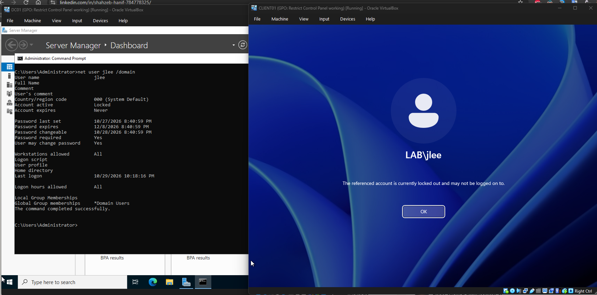
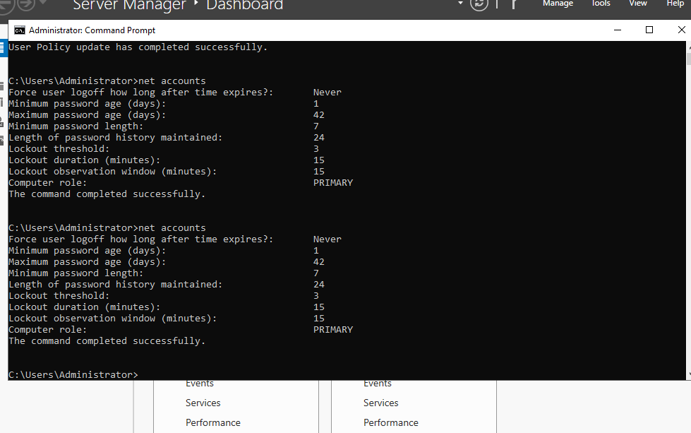
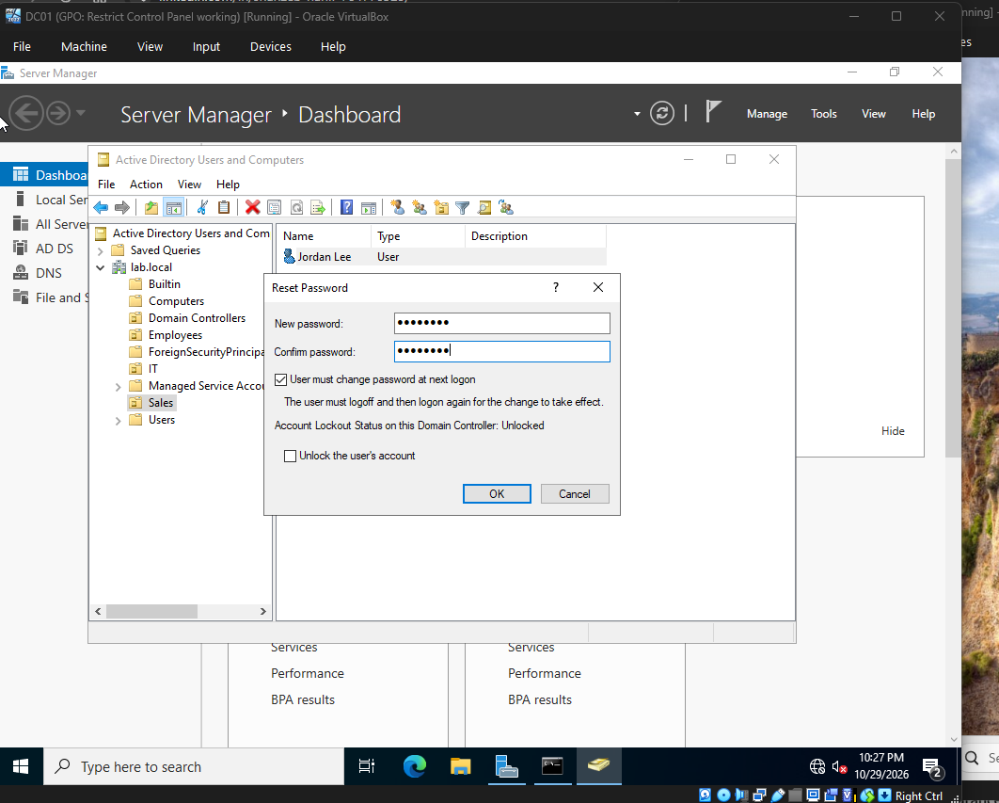
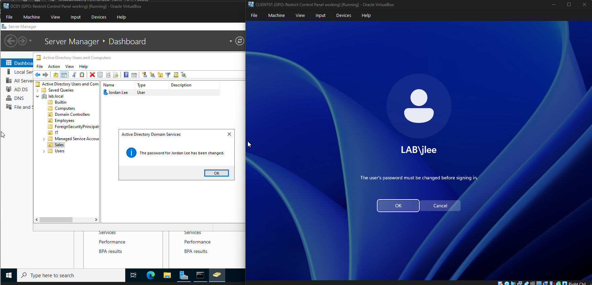
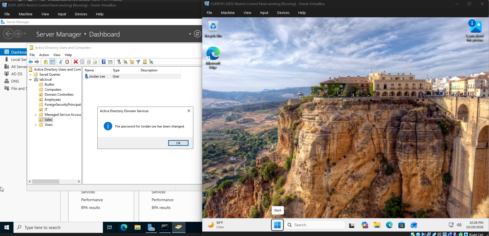

# Ticket 001: Account Locked Out, Password Reset

| Field | Detail |
|---|---|
| Date reported | 2026-10-29, ~10:22 PM |
| User | Jordan Lee (`jlee`), Sales OU |
| Machine | CLIENT01 (Windows 11 Pro, joined to lab.local) |
| Priority | Medium |
| Status | Resolved |
| Time to resolve | ~4 minutes |

## Issue
User could not log in to CLIENT01. The login screen showed:
"The referenced account is currently locked out and may not be logged on to."

## Cause
Repeated incorrect passwords exceeded the domain account lockout threshold, set in the Default Domain Policy (confirmed on DC01 with `net accounts`):

- Account lockout threshold: 3 invalid attempts
- Account lockout duration: 15 minutes
- Reset account lockout counter after: 15 minutes

## Troubleshooting steps
1. On DC01, ran `net user jlee /domain`. The output showed **Account active: Locked**.
2. Opened Active Directory Users and Computers and found Jordan Lee in the Sales OU.
3. Reset the password to a temporary one with **User must change password at next logon** ticked. The dialog showed the account lockout status as Unlocked.

4. Asked the user to sign in at CLIENT01 with the temporary password.

## Resolution
User signed in with the temporary password, was required to set a new one, and reached the desktop.

## What I learned
- The domain controller enforces the lockout, not the client.
- Failed attempts count against the observation window, so a user can lock out sooner than expected.
- Resetting the password in ADUC with a forced change gets the user working while keeping the account secure.

## Prevention
- Remind users about the lockout policy (3 attempts).
- Consider self-service password reset to reduce help desk volume.
